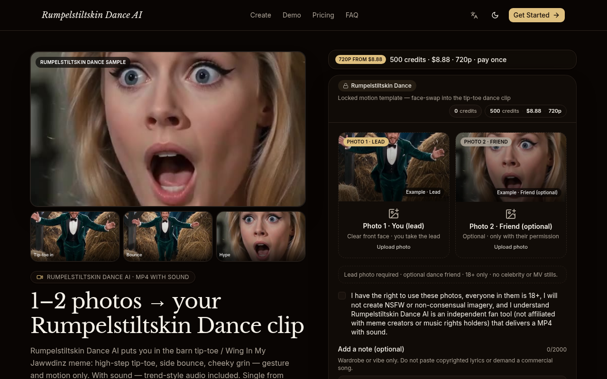
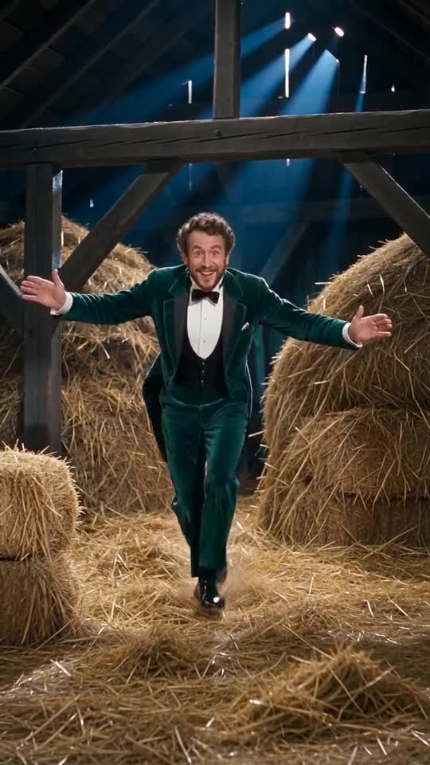
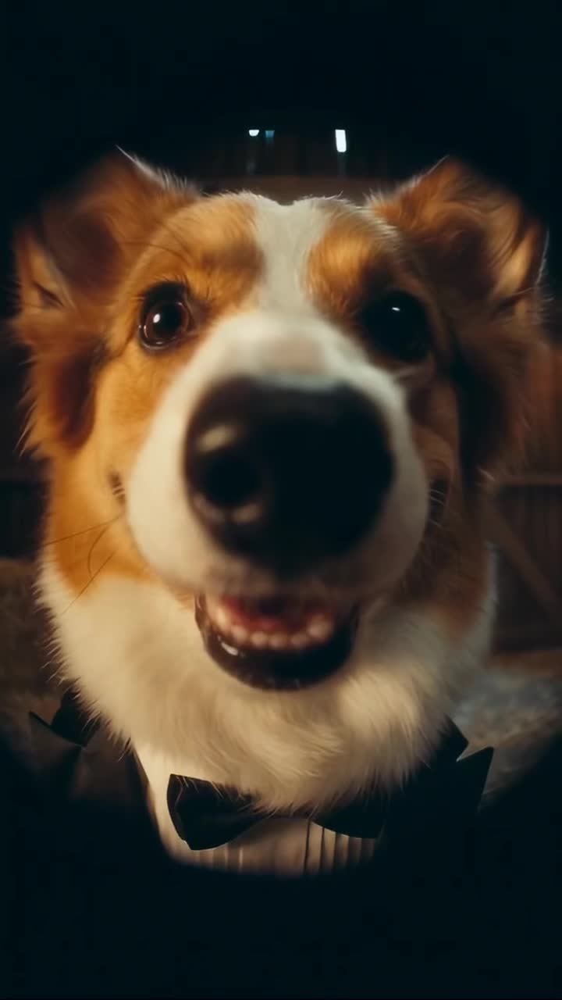

# Rumpelstiltskin Dance AI

  

  <strong>1～2 张照片 → 一段谷仓踮脚舞 AI 短视频</strong> 
  付费成片约 10s · 竖屏友好 · 游客可付 
  起价 <b>$8.88</b> · 无订阅、无需注册

  
  

---

## 截图

  
  

---

## 怎么用

1. 打开 [rumpelstiltskindance.video](https://rumpelstiltskindance.video)
2. 上传 Photo 1（主角，必填）；可选 Photo 2（舞伴/围观者）
3. 勾选授权声明 → 选画幅（竖屏建议 9:16）→ Create
4. 游客可用 Stripe 付费出片（Single **$8.88** / 3-pack **$16.99** / 10-pack **$39.90**）

---

## 产品要点

- **锁定动作模板**：踮脚入场 → 左右弹跳 → 嗨点 → 收尾看镜头（约 **10 秒** 付费成片）
- **单人 / 双人**换脸玩法；画幅 21:9 / 16:9 / 9:16；720p 为主
- 自带趋势风格音频（**非**商业歌曲）；可在 TikTok / Reels 自行换歌
- 独立粉丝工具，与梗原作者、音乐版权方无关联

---

## 定价

| 套餐 | 价格 | 积分 |
|---|---|---|
| Single | $8.88 | 500 ≈ 1×720p |
| 3-pack | $16.99 | 1500 ≈ 3×720p |
| 10-pack | $39.90 | 5000 ≈ 10×720p |

一次性积分包，无订阅。英文简介：*Upload 1–2 photos → face into a locked barn tip-toe dance template → MP4 with trend-style audio.*

---

## Links

- 官网：https://rumpelstiltskindance.video
- GitHub Pages：https://xianyu110.github.io/rumpelstiltskin-dance/
- 仓库：https://github.com/xianyu110/rumpelstiltskin-dance

---

## License

Demo media for product showcase. Site © Maynor / xianyu110. Please only upload photos you own or have permission to use. Fan tool — unaffiliated with original artists, labels, or rights holders.
